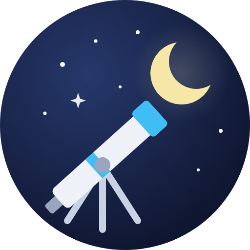

<p align="center">
  
</p>

<h1 align="center">Sky Tonight</h1>

<p align="center">
  A Home Assistant integration that tells you what's in the sky tonight: when it gets properly
  dark, which planets you can see and when, the Moon, and upcoming eclipses, meteor showers, and
  other celestial events, all worked out for your location.
  Powered by <a href="https://github.com/cosinekitty/astronomy">Astronomy Engine</a>.
</p>

<p align="center">
  <a href="https://hacs.xyz/docs/faq/custom_repositories/"></a>
</p>

Sky Tonight is the companion integration to the
[Sky Tonight Card](https://github.com/wwwescape/sky-tonight-card). The card shows the sky; the
integration turns the same information into entities you can use in automations, scripts,
notifications, and your own dashboards.

Everything is calculated locally. There's no cloud service, account, or API key.

## Features

- **Planet visibility**: a `visible` binary sensor for the Moon and each planet that's on only
  when the object is high enough *and* the sky is dark enough for something that bright. Venus
  shows up in early twilight; Neptune waits for a properly dark sky.
- **Tonight's plan**: which planets you'll be able to see tonight, from when, until when, and
  when each is highest.
- **Darkness**: the current twilight stage, astronomical dusk and dawn, how many hours of real
  darkness tonight has, and how many of those are free of moonlight.
- **The Moon**: phase, illumination, rise and set, and the next new, full, and quarter moons.
- **Events**: the next lunar and solar eclipses visible from your location, the next meteor
  shower peak (with the best time to look and how bright the Moon will be), and the next
  opposition, greatest elongation, supermoon, equinox, or solstice.
- **Multiple locations**: add the integration once for each place you observe from.

## Installation

### HACS (recommended)

1. Open HACS, click the ⋮ menu in the top right corner, and choose **Custom repositories**.
2. Paste `https://github.com/wwwescape/sky-tonight`, choose **Integration** as the type, and
   click **Add**.
3. Search for **Sky Tonight** and download it.
4. Restart Home Assistant.

### Manual

1. Copy `custom_components/sky_tonight` into `<config>/custom_components/`.
2. Restart Home Assistant.

## Setup

Go to **Settings → Devices & services → Add integration** and search for **Sky Tonight**.

| Option               | Description                                                                                                                         |
| -------------------- | ----------------------------------------------------------------------------------------------------------------------------------- |
| **Name**             | The device name, and the prefix for entity IDs. Defaults to `Sky Tonight`.                                                          |
| **Location**         | Where you observe from. Defaults to your home.                                                                                      |
| **Elevation**        | Height above sea level, in metres.                                                                                                  |
| **Minimum altitude** | How high above the horizon something must be to count as visible. Defaults to 10°; raise it if trees or buildings block a low sky. |

You can change the minimum altitude later from the integration's **Configure** button, and move
the location with **Reconfigure**.

## Entities

Entity IDs below assume the default name, `Sky Tonight`. Entities marked *disabled* are created
but switched off by default; enable them from the entity's settings if you want them.

### Planets and the Moon

For the Moon and each planet (Mercury, Venus, Mars, Jupiter, Saturn, Uranus, Neptune):

| Entity                                       | Description                                                                         |
| -------------------------------------------- | ----------------------------------------------------------------------------------- |
| `binary_sensor.sky_tonight_<body>_visible`   | On when the object can realistically be seen right now (see [Visibility](#visibility)). |

Its attributes include `altitude`, `azimuth`, `direction` (compass point), `magnitude`,
`constellation`, `optics` (`naked_eye`, `binoculars`, or `telescope`), `next_rise`, `next_set`,
and, for tonight, `visible_tonight`, `visible_from`, `visible_until`, `best_time`, and
`max_altitude`.

For each planet:

| Entity                                     | Description                                       |
| ------------------------------------------ | ------------------------------------------------- |
| `sensor.sky_tonight_<planet>_altitude`      | Degrees above (or below) the horizon              |
| `sensor.sky_tonight_<planet>_rise`          | Next rise                                         |
| `sensor.sky_tonight_<planet>_set`           | Next set                                          |
| `sensor.sky_tonight_<planet>_azimuth`       | Compass bearing in degrees *(disabled)*           |
| `sensor.sky_tonight_<planet>_magnitude`     | Apparent brightness; lower is brighter *(disabled)* |
| `sensor.sky_tonight_<planet>_constellation` | The constellation it's in *(disabled)*            |

### Overview

| Entity                                         | Description                                                                                       |
| ---------------------------------------------- | ------------------------------------------------------------------------------------------------- |
| `sensor.sky_tonight_visible_planets`           | How many planets are visible right now; the `planets` attribute lists them                        |
| `sensor.sky_tonight_visible_planets_tonight`   | How many planets will be visible at some point tonight; `planets` lists each with its window      |
| `sensor.sky_tonight_darkness`                  | `day`, `civil_twilight`, `nautical_twilight`, `astronomical_twilight`, or `night`                 |
| `sensor.sky_tonight_astronomical_dusk`         | When tonight's astronomical darkness begins (unknown if it never gets fully dark)                 |
| `sensor.sky_tonight_astronomical_dawn`         | When it ends                                                                                      |
| `sensor.sky_tonight_dark_hours_tonight`        | Hours of astronomical darkness tonight                                                            |
| `sensor.sky_tonight_moonless_dark_hours_tonight` | Hours of astronomical darkness with the Moon below the horizon                                  |
| `sensor.sky_tonight_next_dark_sky`             | Start of the current or next moonless dark window tonight; `end` attribute                        |
| `binary_sensor.sky_tonight_dark_sky`           | On while it's astronomically dark and the Moon is down: the best time for faint objects           |

"Tonight" is the night in progress, or the next one if it's daytime: sunset to sunrise.

### The Moon

| Entity                                  | Description                                    |
| --------------------------------------- | ---------------------------------------------- |
| `sensor.sky_tonight_moon_phase`         | One of the eight phases, e.g. `waxing_gibbous` |
| `sensor.sky_tonight_moon_illumination`  | Percentage of the disc that's lit              |
| `sensor.sky_tonight_moon_altitude`      | Degrees above the horizon                      |
| `sensor.sky_tonight_moonrise`           | Next moonrise                                  |
| `sensor.sky_tonight_moonset`            | Next moonset                                   |
| `sensor.sky_tonight_next_new_moon`      | Next new moon                                  |
| `sensor.sky_tonight_next_full_moon`     | Next full moon                                 |
| `sensor.sky_tonight_next_first_quarter` | Next first quarter *(disabled)*                |
| `sensor.sky_tonight_next_last_quarter`  | Next last quarter *(disabled)*                 |
| `sensor.sky_tonight_moon_azimuth`       | Compass bearing *(disabled)*                   |
| `sensor.sky_tonight_moon_distance`      | Distance from Earth in km *(disabled)*         |

### Events

| Entity                                        | Description                                                                                                                                          |
| --------------------------------------------- | ---------------------------------------------------------------------------------------------------------------------------------------------------- |
| `sensor.sky_tonight_next_lunar_eclipse`       | Peak of the next lunar eclipse the Moon is up for at your location; attributes give the kind, obscuration, and phase times                           |
| `sensor.sky_tonight_next_solar_eclipse`       | Peak of the next solar eclipse visible from your location; attributes give the kind, obscuration, and the Sun's altitude                             |
| `sensor.sky_tonight_next_meteor_shower`       | Best viewing time on the next shower's peak night; attributes give the name, ZHR, radiant altitude, Moon illumination, and all upcoming showers       |
| `binary_sensor.sky_tonight_meteor_shower_active` | On while any major shower is active; `active_showers` lists them                                                                                  |
| `sensor.sky_tonight_next_celestial_event`     | The next opposition, greatest elongation, supermoon, equinox, or solstice; `upcoming` lists the next ten                                            |

Eclipses and events look about 18 months ahead, the same as the card.

## Visibility

An object counts as visible when:

1. it's at least the **minimum altitude** above the horizon, and
2. the Sun is far enough below the horizon for something that bright to show:

| Brightness (magnitude) | Example                        | Sun must be below |
| ---------------------- | ------------------------------ | ----------------- |
| −3 or brighter         | Venus                          | −3°               |
| up to 0.5              | Jupiter, Saturn, Mars at its best | −6°            |
| up to 3                | Mars far from Earth, a faint Mercury | −9°         |
| up to 5                | —                              | −12°              |
| fainter                | Uranus, Neptune                | −15°              |

The Moon is the exception: it's often visible in daylight, so it counts whenever it's above the
minimum altitude and isn't new.

The `optics` attribute says what you need: the naked eye down to magnitude 5, binoculars to
magnitude 9, and a telescope beyond that. Weather isn't taken into account; combine these
entities with your weather or cloud cover sensors for that.

## Examples

### Tell me when Saturn is up tonight

```yaml
automation:
  - alias: Saturn is visible
    triggers:
      - trigger: state
        entity_id: binary_sensor.sky_tonight_saturn_visible
        to: "on"
    actions:
      - action: notify.mobile_app_phone
        data:
          title: Saturn is up
          message: >
            Look {{ state_attr('binary_sensor.sky_tonight_saturn_visible', 'direction') }},
            {{ state_attr('binary_sensor.sky_tonight_saturn_visible', 'altitude') | round }}°
            up, in {{ state_attr('binary_sensor.sky_tonight_saturn_visible', 'constellation') }}.
```

### Turn off the garden lights for a dark sky

```yaml
automation:
  - alias: Dark sky
    triggers:
      - trigger: state
        entity_id: binary_sensor.sky_tonight_dark_sky
        to: "on"
    conditions:
      - condition: state
        entity_id: weather.home
        state: clear-night
    actions:
      - action: light.turn_off
        target:
          area_id: garden
```

### Meteor shower reminder

```yaml
automation:
  - alias: Meteor shower tonight
    triggers:
      - trigger: time
        at: sensor.sky_tonight_next_meteor_shower
        offset: "-02:00:00"
    actions:
      - action: notify.mobile_app_phone
        data:
          message: >
            The {{ state_attr('sensor.sky_tonight_next_meteor_shower', 'name') }} peak in two
            hours, with up to {{ state_attr('sensor.sky_tonight_next_meteor_shower', 'zhr') }}
            meteors an hour. The Moon is
            {{ state_attr('sensor.sky_tonight_next_meteor_shower', 'moon_illumination') }}% lit.
```

### A list of what's up tonight

```yaml
type: markdown
content: >
  
  **{{ p.name | title }}**: {{ as_timestamp(p.visible_from) | timestamp_custom('%H:%M') }}
  to {{ as_timestamp(p.visible_until) | timestamp_custom('%H:%M') }},
  best at {{ as_timestamp(p.best_time) | timestamp_custom('%H:%M') }}
  ({{ p.optics | replace('_', ' ') }})
  
```

## Accuracy

Positions, rise and set times, moon phases, and eclipses come from Astronomy Engine and are
accurate to well under a minute. Tonight's visibility windows and dark-sky windows are sampled
every five minutes. Meteor shower dates and rates come from a fixed table of commonly published
figures; real peaks drift by a day or so from year to year.

## Development

```bash
python -m venv .venv
source .venv/bin/activate
pip install -r requirements_test.txt
pytest
```

The astronomy is in `custom_components/sky_tonight/astro.py`, which doesn't import Home
Assistant, so it's easy to experiment with on its own.

## License

MIT; see [LICENSE](LICENSE).

## Support

If you find Sky Tonight useful, consider buying me a coffee:

[](https://buymeacoffee.com/wwwescape)
